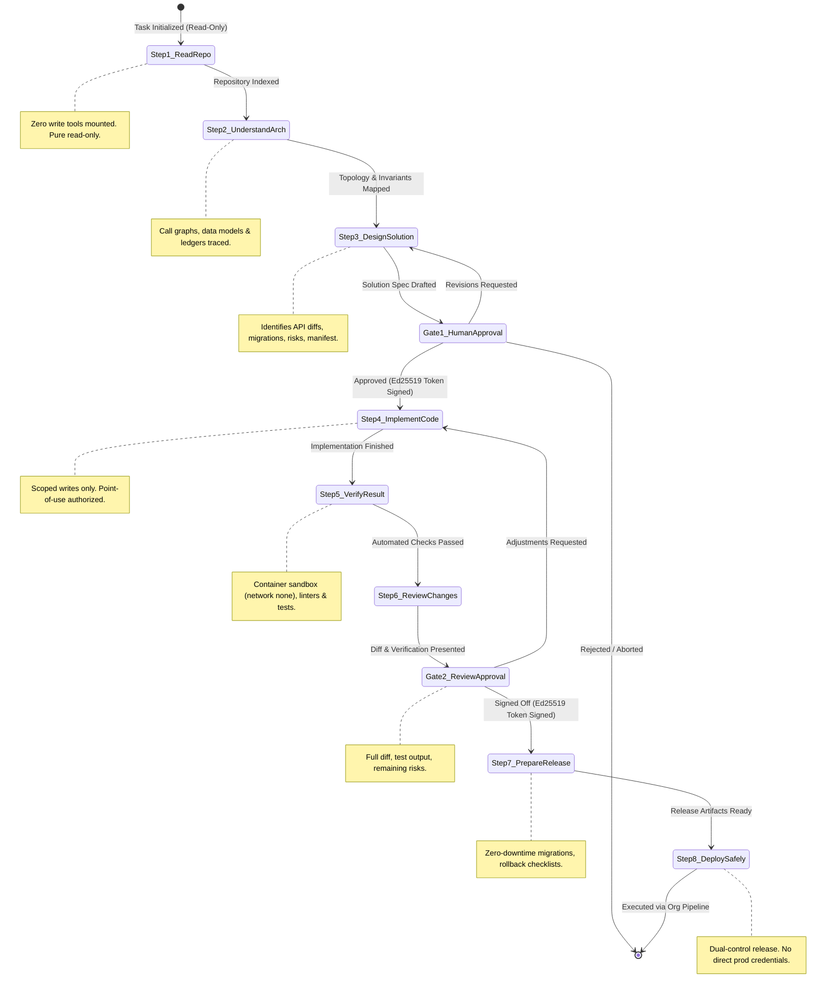

# Privora

> **Privacy-First AI Software Engineering Partner for Fintech, BaaS & High-Compliance Systems**

[](https://golang.org)
[](docs/security.md)
[](pkg/fsm)
[](LICENSE)

---

## 1. What Is Privora?

**Privora** is an autonomous yet strictly supervised AI software engineering partner built specifically for regulated, high-stakes environments—such as fintech platforms, Banking-as-a-Service (BaaS) infrastructures, payment gateways, and core ledger engines.

Unlike conventional AI code assistants that act as reactive chatbots streaming proprietary repository code to multi-tenant cloud APIs, Privora enforces an immutable **Zero-Leakage Guarantee**:

1. **Confidential Context Stays Local:** Repository source code, ASTs, file paths, diffs, database schemas, and stack traces never leave the developer's local workstation or the customer's private cloud VPC. Encryption in transit to third-party AI providers is explicitly rejected as a privacy solution. Redaction and anonymization are rejected as sufficient mechanisms for external routing.
2. **Deterministic 8-Step Workflow Governance:** An architectural finite state machine (FSM), enforced at the host daemon layer, mechanically governs the full engineering lifecycle. The agent cannot self-authorize stage transitions or tool executions; human cryptographic sign-offs are mandatory at key gates.
3. **Fintech Invariant Awareness:** Privora treats financial software differently from generic code. It actively verifies double-entry balance conservation, non-floating-point currency representations, transaction isolation levels, idempotency guarantees, and non-locking database migrations.
4. **Zero-Trust Input Model:** All repository files, git histories, issue tickets, comments, and tool outputs (stdout/stderr) are treated as untrusted data subject to indirect prompt injection and supply-chain attacks.

---

## 2. Mandatory Eight-Step AI Coding Workflow

Privora enforces a strict, stage-gated lifecycle. The agent cannot skip stages, self-approve transitions, or execute tools designated for later stages without explicit human approval.



### The Eight Stages

| Stage | Objective | Tool Boundary | Human Gate Controls |
| :--- | :--- | :--- | :--- |
| **Step 1: Read the existing repository** | Examine project files, dependencies, database models, and documentation. | Read-Only inspection (`view_file`, `list_symbols`). Write tools are unmounted. | None (Automated read) |
| **Step 2: Understand the architecture** | Trace workflows (auth, payments, ledger updates). Identify failure cases and invariants. | Read-Only inspection (`trace_call_graph`). Write tools are unmounted. | None (Automated trace) |
| **Step 3: Design the solution** | Draft solution document, API diffs, schema changes, tests, and approved file manifest. | Design drafting tools only. | **GATE 1 (Mandatory Sign-Off):** Requires an Ed25519 token from an authorized Architect/Lead bound to the design hash. |
| **Step 4: Implement the code** | Make agreed changes strictly within the authorized file manifest. | Write tools permitted **only** for approved manifest files. | Scope violations rejected at point of use. |
| **Step 5: Verify the result** | Run tests, linters, type checks, and security scans in an isolated sandbox. | Execution tools permitted inside non-networked container. | Failed tests trigger loopback to Step 4. |
| **Step 6: Review the changes** | Present unified diff, test output, invariant checks, and risk analysis to engineer. | Read-Only diff presentation. | **GATE 2 (Mandatory Sign-Off):** Requires human sign-off before release preparation. |
| **Step 7: Prepare for safe release** | Generate zero-downtime migration scripts, rollback plans, and monitoring alerts. | Release checklist tools only. | No automated production deployments. |
| **Step 8: Deploy safely** | Hand off release bundle to the organization's approved CI/CD release pipeline. | CI payload generator (read-only). | Dual-control human & organizational sign-off. |

---

## 3. Core Architecture & Security Foundation

```
+-----------------------------------------------------------------------------------------+
|                                    PRIVORA TOPOLOGY                                      |
|                                                                                         |
|   +-----------------------+     Authenticated Local Socket     +---------------------+  |
|   |  Presentation Layer   | <================================> |   privorad Daemon   |  |
|   | (React + TS + Vite)   |                                    |      (Go Core)      |  |
|   +-----------------------+                                    +----------+----------+  |
|                                                                           |             |
|         +-------------------+--------------------+------------------------+             |
|         |                   |                    |                        |             |
|         v                   v                    v                        v             |
|  +--------------+   +---------------+   +------------------+   +--------------------+   |
|  | 8-Step State |   | Scoped File   |   | Key Registry &   |   | Pre-DNS Egress     |   |
|  | Machine FSM  |   | System Guard  |   | Ed25519 Trust    |   | Guard & Transport  |   |
|  | (pkg/fsm)    |   | (pkg/storage) |   | (pkg/fsm/trust)  |   | (pkg/policy)       |   |
|  +--------------+   +---------------+   +------------------+   +--------------------+   |
|                                                                           |             |
|         +----------------------------------------+------------------------+             |
|         |                                        |                                      |
|         v                                        v                                      |
|  +------------------------------+       +--------------------------------------------+  |
|  | Isolated Container Sandbox   |       | Local Model Runtime (Decoupled)            |  |
|  | - Docker / Podman            |       | - llama.cpp / Ollama / Private VPC vLLM    |  |
|  | - Network: NONE (drop all)   |       | - Loopback HTTP / mTLS only                |  |
|  +------------------------------+       +--------------------------------------------+  |
+-----------------------------------------------------------------------------------------+
```

### Key Security Mechanisms (P0-1 Verified)

* **Authoritative Key Registry (`pkg/fsm/trust.go`):** Eliminates blind trust in caller-supplied keys. Public keys are provisioned in an authoritative registry binding approvers to explicit roles (`Principal Architect`, `Engineering Lead`, `Security Architect`, `Release Lead`). Supports instant key revocation.
* **Cryptographic Token Binding (`pkg/fsm/fsm.go`):** Tokens are digitally signed with Ed25519 across `(TokenID, SessionID, ApproverID, Role, ArtifactHash, Timestamp)`. Tokens are bound to the SHA-256 design hash and active session ID, enforce a 15-minute maximum TTL, and prevent replay attacks through atomic consumption.
* **Point-of-Use Filesystem Authorization (`pkg/storage/scoped_fs.go`):** Write authorization is enforced directly inside the filesystem I/O operations (`WriteFile`), verifying active stage and approved manifest membership immediately prior to disk writes, completely eliminating Time-of-Check to Time-of-Use (TOCTOU) decoupling.
* **Path Confinement & Symlink Defense (`pkg/fsm/path_security.go`):** All operations anchor to the repository root. Rejects null-byte poisoning, Windows alternate data streams (`file:stream`), parent traversal (`../../`), and resolves symlinks across existing and newly created files.
* **Pre-DNS Egress Guard (`pkg/policy/network_guard.go` & `pkg/policy/egress.go`):** Intercepts outbound traffic before DNS resolution. External hostnames (e.g. `api.openai.com` or arbitrary exfiltration subdomains) are dropped pre-DNS, shutting down DNS data exfiltration. Direct TCP/UDP socket dials and HTTP redirect escapes are mechanically blocked.

---

## 4. Repository Structure

```
privora/
├── go.mod                      # Module definition (Go 1.22+)
├── .gitignore                  # Git exclusions for binaries, temp files, and caches
├── README.md                   # Project overview, architecture, and workflow guide
└── pkg/
    ├── fsm/                    # Eight-Step Workflow Finite State Machine
    │   ├── stage.go            # Stage definitions (1-8), string names, read-only checks
    │   ├── errors.go           # Canonical security and state machine sentinel errors
    │   ├── trust.go            # Authoritative KeyRegistry, TrustedApprover, role bindings
    │   ├── path_security.go    # PathValidator, symlink resolution, traversal checks
    │   ├── fsm.go              # StateMachine core, Gate 1 & 2 transitions, token validation
    │   └── fsm_test.go         # Adversarial unit tests (replay, tampering, traversal)
    ├── storage/                # Authorized Filesystem Layer
    │   ├── scoped_fs.go        # ScopedFileSystem, point-of-use write authorization
    │   └── scoped_fs_test.go   # Point-of-use authorization tests
    ├── tools/                  # Tool Registry & Permissions
    │   ├── registry.go         # Tool definitions, stage permissions, execution delegate
    │   └── registry_test.go    # Read-only stage checks and write tool scope tests
    └── policy/                 # Security & Privacy Policy Enforcement
        ├── provenance.go       # Taint tracking types (TAINTED_CONFIDENTIAL_REPO)
        ├── network_guard.go    # Pre-DNS host checks, EgressGuardDialer, redirect checks
        ├── egress.go           # EgressGuardTransport (RoundTripper), secure HTTP client
        ├── container_isolation.go # Container sandboxing configuration (NetworkMode: none)
        └── provenance_test.go  # Outbound leak, DNS exfiltration, and socket tests
```

---

## 5. Getting Started & Testing

### Prerequisites
* **Go:** Version 1.22 or higher
* **Git:** Version 2.30+
* **Docker / Podman:** For container-sandboxed execution (Step 5)

### Running the Test Suite
Privora maintains a comprehensive adversarial test suite covering token replay, role escalation, path traversal, symlink escapes, and outbound egress interception.

```bash
# Clone the repository
git clone https://github.com/Maddyahamco00/Privora.git
cd Privora

# Run all unit tests cleanly (disabling test cache)
go test -v -count=1 ./...

# Run static analysis
go vet ./...
```

---

## 6. Engineering Roadmap

* [x] **Phase 0:** Architecture Evaluation, Threat Modeling, Benchmarking Framework & ADR-001–008.
* [x] **Task P0-1:** Core Engine — 8-Step FSM, Key Registry, Scoped FS, and Egress Guard.
* [ ] **Task P0-2:** Deterministic Secret Scanner Engine (Aho-Corasick entropy and pattern detection).
* [ ] **Task P0-3:** Container Execution Sandbox (Docker / Rootless Podman with `--network none`).
* [ ] **Task P0-4:** Local Inference Gateway & Tool Calling (llama.cpp / Ollama adapter).
* [ ] **Task P0-5:** Desktop & Web Console UI (React + TypeScript + Vite).
* [ ] **Task P0-6:** Fintech Safety & Invariant Engine (Double-entry ledger rules, non-floating-point currency).

---

## 7. License

Licensed under the Apache License, Version 2.0. See [LICENSE](LICENSE) for details.
